<!-- ═══════════════════════════ HEADER ═══════════════════════════ -->
<p align="center">
  
</p>

<p align="center">
  <a href="https://github.com/abhasgupta07">
    
  </a>
</p>

<p align="center">
  
  <a href="https://github.com/abhasgupta07?tab=followers"></a>
  <a href="https://github.com/abhasgupta07?tab=repositories"></a>
</p>


## 🖥️ `$ whoami`

```text
 ┌──────────────────────────────────────────────────────────┐
 │  👤 USER        : Abhas Gupta  (@abhasgupta07)           │
 │  🌍 LOCATION    : India 🇮🇳                              │
 │  💼 ROLE        : Full-Stack Developer                   │
 │  📚 LEARNING    : C++  •  Java  •  JavaScript            │
 │  🧩 PRACTICE    : LeetCode / Problem Solving             │
 │  💬 ASK ME ABOUT: Full-Stack Web Development             │
 │  📫 CONTACT     : abhasgupta737@gmail.com                │
 │  ⚡ STATUS      : Compiling ideas into products...       │
 └──────────────────────────────────────────────────────────┘
```


## ⚙️ Tech Stack

<p align="center">
  <a href="https://skillicons.dev">
    
  </a>
</p>

### 🧠 Skill Loading Bars

```text
 HTML / CSS    [██████████████████░░]  90%
 JavaScript    [███████████████░░░░░]  75%
 Full-Stack    [██████████████░░░░░░]  70%
 C++           [███████████░░░░░░░░░]  55%
 Java          [██████████░░░░░░░░░░]  50%
```

> 💡 The percentages are placeholders, so edit them to match your own level.


## 🗺️ Learning Roadmap

```mermaid
flowchart LR
    A([HTML / CSS / JS]) --> B([Full-Stack Web Dev])
    B --> C([C++ & DSA])
    C --> D([Java])
    D --> E([System Design])
    E --> F([Build & Ship Big Projects 🚀])
    style A fill:#0d1117,stroke:#00f5ff,color:#00f5ff
    style B fill:#0d1117,stroke:#00f5ff,color:#00f5ff
    style C fill:#0d1117,stroke:#7b2ff7,color:#c9a8ff
    style D fill:#0d1117,stroke:#7b2ff7,color:#c9a8ff
    style E fill:#0d1117,stroke:#ff00c8,color:#ff8ee6
    style F fill:#0d1117,stroke:#ff00c8,color:#ff8ee6
```




## 📊 GitHub Analytics

<p align="center">
  
  
</p>

### 🔥 Contribution Streak

<p align="center">
  
</p>

### 📈 Contribution Activity Graph

<p align="center">
  
</p>

### 🌐 3D Contribution Universe

<!-- Generated by the 3d-contrib.yml workflow. It appears after the first run. -->
<p align="center">
  
</p>

### 🏆 Trophies

<p align="center">
  <a href="https://github.com/ryo-ma/github-profile-trophy">
    
  </a>
</p>


## 🚀 Featured Projects

<!--
  HOW TO EDIT: replace every REPO_NAME_x below with the exact name of your repository.
-->

<p align="center">
  <a href="https://github.com/abhasgupta07/REPO_NAME_1">
    
  </a>
  <a href="https://github.com/abhasgupta07/REPO_NAME_2">
    
  </a>
</p>
<p align="center">
  <a href="https://github.com/abhasgupta07/REPO_NAME_3">
    
  </a>
  <a href="https://github.com/abhasgupta07/REPO_NAME_4">
    
  </a>
</p>


## ⚡ Live Activity Feed

<!-- Auto-updated by the activity.yml workflow. Do not remove the markers. -->
<!--START_SECTION:activity-->
<!--END_SECTION:activity-->


## 🐍 Contribution Snake

<p align="center">
  <picture>
    <source media="(prefers-color-scheme: dark)" srcset="https://raw.githubusercontent.com/abhasgupta07/abhasgupta07/output/github-snake-dark.svg" />
    <source media="(prefers-color-scheme: light)" srcset="https://raw.githubusercontent.com/abhasgupta07/abhasgupta07/output/github-snake.svg" />
    
  </picture>
</p>


## 💭 Dev Quote of the Moment

<p align="center">
  
</p>


## 🤝 Connect With Me

<p align="center">
  <a href="https://linkedin.com/in/YOUR-LINKEDIN-USERNAME"></a>
  <a href="https://instagram.com/abhasgupta07"></a>
  <a href="https://leetcode.com/u/YOUR-LEETCODE-USERNAME"></a>
  <a href="mailto:abhasgupta737@gmail.com"></a>
</p>

<p align="center">
  
</p>

<p align="center">
  
</p>
